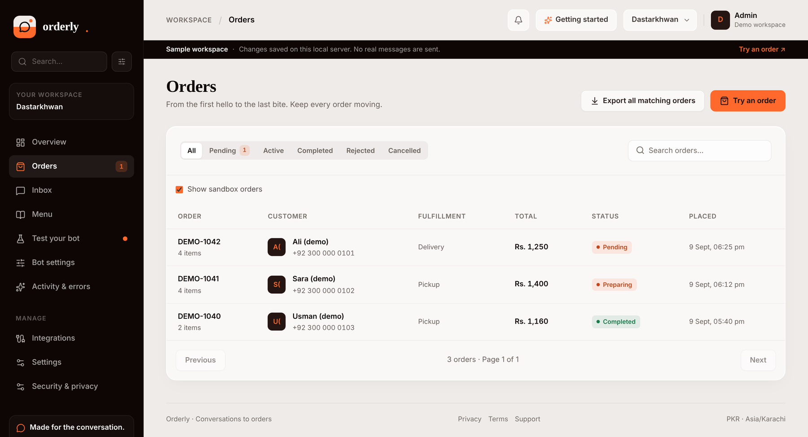
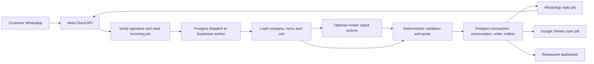

# Orderly

<p>
  <a href="https://orderly.meerurayyan.workers.dev"><b>Live site</b></a> ·
  <a href="#run-locally">Run locally</a> ·
  <a href="docs/DEPLOYMENT.md">Deployment guide</a>
</p>

[](https://github.com/RayyanRS6/orderly/actions/workflows/deploy-backend.yml)
[](https://github.com/RayyanRS6/orderly/actions/workflows/check-gateway.yml)



A WhatsApp ordering platform for restaurants in Pakistan. Customers order through the restaurant’s WhatsApp number in English, Urdu or Roman Urdu; owners and staff manage menus, orders and conversations from this dashboard. Orderly replaces n8n with its own TypeScript ordering engine.

**Status (October 2026): pilot.** Two test restaurants run on the live Cloudflare and Supabase setup, and a friend's restaurant is the first real one to go live, before any other client. Both WhatsApp routes are in use: the official Meta Cloud API and, for restaurants the platform admin enables, the unofficial linked phone. Customers pay the restaurant directly: the order confirmation and the menu page say cash at pickup or on delivery, and any JazzCash, Easypaisa or bank transfer is arranged with the restaurant and checked by its staff. Orderly takes no payments and never asks for payment details. Earlier records from the launch: the [implementation and launch handover](docs/ORDERLY-IMPLEMENTATION-2026-09-17.md), the [audit](docs/ORDERLY-AUDIT-2026-09-16.md) and the [Pakistan budget](docs/ORDERLY-BUDGET-2026-09-16.md).

**Start here:** [Get Orderly running](docs/GET-IT-RUNNING.md) is the current step-by-step checklist (accounts, Claude Haiku 5.5, WhatsApp, per-client setup and costs). Before going live also read the [deployment guide](docs/DEPLOYMENT.md) (release order and owner actions), [backups and the restore drill](docs/BACKUP-AND-RESTORE.md), the [incident runbook](docs/INCIDENT-RUNBOOK.md) and the [compliance notes](docs/COMPLIANCE-NOTES-2026-10-18.md). In the dashboard, **Agent flow** shows everything connected to a business's bot, what is missing, and why the bot sent each reply.

## Run locally

Requires Node.js 22.12+ or 24+. Tested with Node 24 on Windows.

```powershell
npm ci
npm run dev
```

Open [Orderly locally](http://127.0.0.1:5173). The API listens on `127.0.0.1:4000`.

No `.env` file is needed for the demo. If you want to configure integrations locally, copy `.env.example` to `.env`. Keep `APP_MODE=demo` while exploring. Never commit `.env`, `.local`, or service account files.

The fictional Dastarkhwan and Bun & Co. workspaces have separate menus, sample orders, and conversations. Changes are persisted to `.local/data.json`. It is a single-process development store, not the production database. Back up that file and `.local/credential.key` together if you save credentials locally.

### Try the full flow

1. In **Bot settings**, select a live AI provider/model, approve its data terms, save it, and run the generation test.
2. Save a behavior draft, then open **Test your bot** and choose Draft or Published.
3. Send `menu`, then `2 chicken biryani` (or a spelling such as `2 biriyani`).
4. Use **Add order details** to send a name and pickup or delivery details through the same text path as WhatsApp.
5. Check the total, then **Confirm order**.
6. Open **Orders**, select the new order, and **Accept order**.

Try `mujhe 2 biryani chahiye`, `مینو`, a sold-out item, an ambiguous family such as `lassi`, or **Talk to staff**. The customer-facing tester always uses the selected model and never silently falls back to local canned rules. Provider usage charges and quotas apply.

**Test your bot creates demo conversations, even on a live deployment.** These never send WhatsApp messages or write order rows to Sheets. A Sheet-backed menu is refreshed for testing, so the simulated customer sees the current catalog.

Local demo mode does not automatically dispatch cloud queue jobs. Use **Integrations → Retry failed jobs** to process pending Sheet jobs locally after configuring a test spreadsheet. Hosted automatic processing requires the Supabase worker and Vault-backed scheduler configuration.

## What is implemented

- Responsive dashboard, business switching and creation, menu CRUD, variants, extras, availability, and CSV import.
- Pickup, cash delivery, delivery areas and fees, opening days/hours, approved FAQ answers.
- English, Urdu and Roman Urdu ordering responses; prices calculated in integer paisa.
- Persistent cart, versioned customer review, explicit confirmation, and pending orders awaiting staff acceptance.
- Order status workflow, export CSV, inbox, staff takeover and manual replies.
- OpenAI, Anthropic and Gemini adapters. Every business uses its own API key, stored encrypted; Orderly never supplies one. Provider changes keep the same application rules.
- Monthly AI budget reservations, bounded model context/actions, conservative accounting for uncertain calls ($0 for calls the provider refused), and message burst handoff.
- Spam protection: AI replies per hour for the restaurant and per customer, one notice an hour, automatic return to the bot when a limit resets, limit alerts, and blocked numbers dropped on arrival.
- Public menu page per business (`/m/<slug>`) with item photos: one-tap ordering from the link the bot sends, and Instagram/QR orders confirmed by sending a short code from the customer's own WhatsApp, with no AI call.
- Anthropic prompt caching of the fixed instructions (same words, lower cost), priced in the usage ledger.
- A platform-admin People page listing every business's owners and staff, with add, role change, removal and account deletion.
- Direct Meta webhook verification, message deduplication, outbound replies and status templates.
- Embedded Signup UI, server code exchange, granted account/phone validation, subscription and optional number registration.
- Coexistence live staff-message echoes pause automation and appear in the inbox. This requires eligible Meta Business App onboarding.
- Google Sheets menu reads and order writes with stable order IDs, retries and duplicate-row reconciliation.
- Supabase Auth, tenant membership checks, database RLS, atomic order/outbox transactions, and worker leases.
- Incoming messages process in arrival order per company and customer, including retries; failed messages block later automation until recovery.
- Cloudflare static hosting, Hono on Supabase Edge Functions, and Postgres job dispatch with minute recovery. Repeated worker crashes stop after five attempts. No n8n service is used.

## How the brain works



The **Agent flow** page (`/app/<business>/flow`) draws this pipeline from live data (`GET /api/agent-flow`, built in `server/agent-flow.ts`). Each bot reply also stores a small explanation (settings version, model, proposed actions, matched rule, engine corrections, who wrote each part, token cost) inside the conversation, shown as **Why this reply?** in Test your bot and the Inbox. Model defaults, prices and context limits live in `src/shared/models.ts`, so the page and the running code always agree.

`src/domain/engine.ts` is the portable core. A model can interpret an item request or suggest an action; it cannot select another company, supply a price, write to a database, or accept an order. Replies about transactions come from the engine. FAQ responses use owner-approved text rather than arbitrary model prose.

A customer must see the current quote and explicitly confirm it. A price, option, delivery fee or cart change requires another review. Postgres rechecks the catalog at order insertion. Concurrent acceptance and cancellation use a conditional status update; customer cancellation also checks bot/staff ownership and commits its conversation state atomically. Outbox jobs are saved with the transaction, so a queue dispatch failure does not erase an order.

Model independence means stable rules and interchangeable adapters. It does not mean every model understands customer language equally well. Evaluate new model IDs on real restaurant examples before enabling them.

## Validation

```powershell
npm run typecheck
npm test
npm run test:edge-runtime
npm run format
```

The **Deploy Supabase backend** workflow runs the first three on every push to `main` and deploys the backend only when they pass. Tests cover the engine, Hono API, local persistence, credential encryption, imports, webhook signatures, replay protection, staff permissions and coexistence echoes. The Postgres suite executes the actual migrations in PGlite, including transactions, RLS, grants, catalog changes, budget holds and competing order updates. These are local tests, not a substitute for a real Supabase/PostgREST and Meta staging run.

The browser flow has been exercised at mobile and desktop widths: menu → cart → review → confirm → staff acceptance → company switch.

## Stack and cost decision

The implemented stack is **React/Vite on Cloudflare static hosting + Hono on Supabase Edge Functions + Supabase Postgres/Auth/Cron**, with direct Meta and Google APIs. The [free hosting plan](docs/FREE-HOSTING-PLAN.md) records quotas and tradeoffs. Existing Vercel queue and deployment files have been removed; the model-independent order engine and multi-company database remain.

| Database                      | Free database allowance                 | Why it matters here                                                                             |
| ----------------------------- | --------------------------------------- | ----------------------------------------------------------------------------------------------- |
| Supabase                      | 500 MB, plus 1 GB separate file storage | Postgres transactions, SQL constraints, RLS and Auth fit orders and company membership. Chosen. |
| Firebase / Firestore Standard | 1 GiB, with daily read/write allowances | More free database storage, but a document model and operation-based billing.                   |
| Neon                          | 0.5 GB per project                      | Good Postgres alternative; Supabase’s integrated project services fit this implementation.      |

These allowances were checked September 2026: [Supabase pricing](https://supabase.com/pricing), [Firebase pricing](https://firebase.google.com/pricing), [Neon pricing](https://neon.com/pricing). No comparative latency benchmark has been run. Put the database near the function region and measure actual traffic before choosing more compute.

Local development and the selected hosting plans start at **$0**, within their free quotas. Cloudflare serves the static dashboard; Supabase includes 500,000 function invocations. The scheduler checks for due jobs inside Postgres and invokes workers only for work. Vercel Hobby's personal, non-commercial restriction is one reason for changing hosts. [Cloudflare static pricing](https://developers.cloudflare.com/workers/static-assets/billing-and-limitations/), [Supabase pricing](https://supabase.com/pricing), [Vercel Hobby terms](https://vercel.com/docs/plans/hobby).

Supabase Free works for an early test but can pause after inactivity and has no automatic backups, so the pilot stays on Free with a nightly `npm run backup:db` ([backups and restore](docs/BACKUP-AND-RESTORE.md)). Pro starts at $25/month with the first project, 8 GB disk and daily backups; that is a later upgrade option, not an initial requirement. Multiple restaurants share one project with tenant isolation; a separate paid project per restaurant is not required. [Supabase pricing](https://supabase.com/pricing).

Do not assume messaging or AI is free: confirm the selected model's quota, Google project's billing tier and current destination-country Meta rates before live testing or quoting a client. Hosting quotas are separate from API charges. [Gemini pricing](https://ai.google.dev/gemini-api/docs/pricing), [Meta pricing](https://developers.facebook.com/documentation/business-messaging/whatsapp/pricing).

## Connect real accounts

Follow [the deployment guide](docs/DEPLOYMENT.md) for Supabase, Cloudflare, Meta, Google Sheets and the activation checklist. Server keys are supplied through environment variables; each business's AI, WhatsApp and Sheets credentials go through the encrypted Bot settings and Integrations forms. Do not put service-role, Meta, Google or model secrets in `VITE_*` variables.

## Scope and next milestones

Live-account verification remains necessary. Owners add team members by email and see their team’s emails in Security & privacy, and the platform admin manages everyone on the People page; subscription billing is not implemented. Orders and conversations support pagination and aggregate reporting, and older messages are stored in a paginated archive. The header bell reports unresolved live orders, handoffs and failed jobs. Browser alerts work while the app is open; external email/phone-push escalation is not configured. Opt-in retention is available in Security & privacy and starts disabled.

Coexistence currently handles new staff echoes, including edit/delete notices. Historical chat imports, contact synchronization, full media rendering, voice-note transcription, payments, precise inventory reservations, delivery tracking, and arbitrary workflow building are outside this version. Media requests go to staff. Availability is an item on/off flag, not a stock count. Very large quotes that cannot fit a complete WhatsApp review are held for staff rather than truncated.

External APIs cannot guarantee exactly-once side effects after an ambiguous network timeout. Orders are deduplicated internally; spreadsheet retries reconcile by order ID. A WhatsApp reply may still be repeated if Meta accepted it but the response was lost. Monitor traces and failed jobs during the pilot. Complete the documented provider onboarding, owned-number end-to-end test, backup/restore drill and representative load testing before expanding beyond a small founder-managed restaurant pilot.

## Launch records

The [compliance notes](docs/COMPLIANCE-NOTES-2026-10-18.md) list the outside rules checked on 18 October 2026 and what is still open. The September [audit closure](docs/ORDERLY-AUDIT-CLOSURE-2026-09-18.md) and [step-by-step launch guide](docs/ORDERLY-LAUNCH-STEPS-2026-09-18.md) remain for operator and client setup; both carry notes on what changed since. The original audit remains a point-in-time record.
